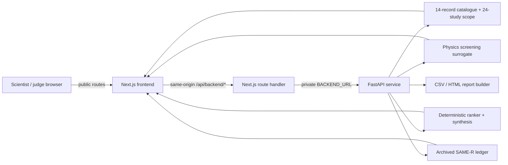

# Production architecture

The production target is a two-service application:

- **frontend/** — Next.js 16 / React 19 / TypeScript scientist dashboard.
- **backend/** — FastAPI with the canonical Python catalogue, physics, ranker, report builder and archived SAME-R ledger.

The frontend never holds scientific logic. It calls the Python API through a same-origin proxy, so the backend stays private and no browser CORS configuration is needed.

## Frontend modules

| Path | Responsibility |
|---|---|
| `frontend/app/page.tsx` | Renders the client workbench |
| `frontend/app/ui/dashboard.tsx` | Five workspace modes, habitat presets, scenario builder, catalogue, comparison, synthesis, SAME-R lab, scope matrix, report downloads |
| `frontend/app/ui/charts.tsx` | Four native responsive SVG charts with axes, grids, legends, tooltips and hover states |
| `frontend/app/ui/model.ts` | API types, tab definitions, habitat presets, formatters and scenario helpers |
| `frontend/app/globals.css` | Dark aerospace design system and responsive layout |
| `frontend/app/api/backend/[...path]/route.ts` | Same-origin proxy; forwards GET/POST and preserves download headers |

No charting library, CSS framework or additional runtime dependency is used. The four charts are:

1. **O₂/pressure envelope** — BASS-II/SAFFIRE boundary, propagation and self-extinguishing zones, normoxic isobar, five habitat markers and the active scenario.
2. **Partial-gravity bounding** — MOC and flame-spread curves, lunar dip annotation, E-FIELD equivalent, LUCI/FM2 target box.
3. **Ranked evidence** — factor-by-factor stacked bars plus evidence coverage and physics proximity.
4. **SAME-R telemetry** — phase/band agreement strip, exception positions, lag correlation and SAME-vs-DAFT dust panel.

## Backend modules

| Path | Responsibility |
|---|---|
| `backend/app/main.py` | Validated JSON API, scope and habitat endpoints, report responses |
| `backend/src/catalogue.py` | Five habitat profiles, 24-study scope matrix, deterministic ranker, physics surrogate, cross-investigation synthesis |
| `backend/src/reporting.py` | CSV/HTML reports with habitat parameters, scope note, citations and SAME-R summary |
| `backend/app/archive.py` | Cached reconciliation of archived SAME-R cycles to historical checkpoints |
| `backend/data/catalogue/investigations.json` | 14 deeply indexed, DOI-linked NASA PSI records |
| `backend/data/metadata/` | Archived cycle sequences, phase summaries, exception identities and metrics |

`data/catalogue/investigations.json` and `backend/data/catalogue/investigations.json` are byte-identical. The root `src/` modules are compatibility facades/copies for the legacy Streamlit path; the backend remains the single source of truth.

## Request flow

1. On load, the dashboard requests `/api/backend/investigations`, `/samer/runs`, `/health`, `/habitats` and `/repository/scope`.
2. The habitat list renders five preset cards. Clicking one populates the scenario and POSTs `/api/backend/simulate`.
3. `/simulate` returns the physics surrogate, ranked 14-record evidence, synthesis and repository scope. The dashboard renders Charts A–C and the KPI strip.
4. Selecting 2–4 catalogue records POSTs `/api/backend/compare` and renders the matrix, deltas and shared-hardware synthesis.
5. Selecting a SAME-R run loads its summary and validation; cycle lookup returns exact source-row and CSV-line references.
6. CSV/HTML downloads POST the active scenario (including `habitat_id`) and return an in-memory report with habitat parameters and the full 24-study scope note.

## 24-study scope accounting

`GET /repository/scope` returns a single authoritative structure:

- `total_investigations: 24`
- `deeply_indexed_count: 14` with Tier 1 ids, names and focus
- `associated_count: 10` with Tier 2 names and focus
- `aggregate_telemetry_tb: 12.4`
- upcoming LUCI and FM2 bounding statements
- identifier reconciliation and limitations

The dashboard renders it as a collapsible scope matrix; reports embed it in HTML and per-row CSV columns; Streamlit shows it in an expander.

## Legacy Streamlit path

`app/streamlit_app.py` remains an optional local fallback. It imports the same 14-record catalogue through the root facade, displays dynamic record counts, and includes the 24-study scope expander. It is not the production deployment.

## Local paths and deployment

`.\start-local.ps1` starts FastAPI on `127.0.0.1:8000` and Next.js on `localhost:3000`, verifies the proxy and opens the dashboard.

The root `vercel.json` describes Vercel Services: FastAPI at `backend/app/main.py`, Next.js in `frontend/`, a private `BACKEND_URL` binding and a public rewrite only to the frontend. No database, upload bucket or external SI key is required. Report bytes are generated in memory; archive files are read-only.

The deployed backend does **not** bundle the six original PSI-101 CSVs because their redistribution terms are not established. It serves an explicitly labelled archived-output view with source-row references, never fabricated measurements.
